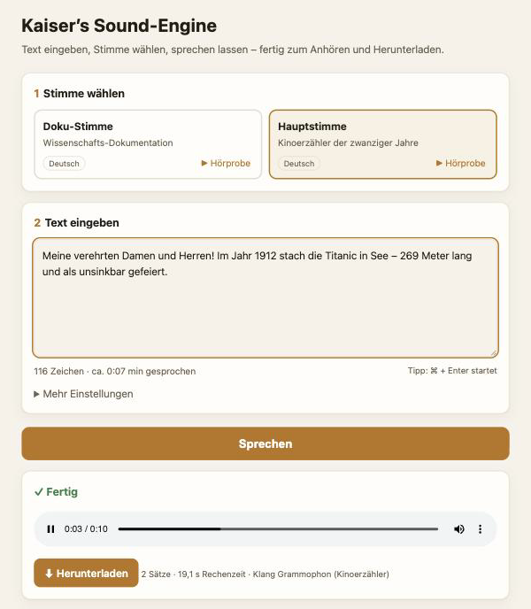

# Kaiser's Sound-Engine

**Text eingeben, Stimme wählen, sprechen lassen – fertig zum Anhören und Herunterladen.**
Natürliche Sprachausgabe (Text-to-Speech) mit zwei Erzählerstimmen, komplett lokal auf dem Mac: kein Internet nach der
Einrichtung, kein Abo, deine Texte verlassen den Rechner nie. Mit einfacher Oberfläche im Browser – und für Fortgeschrittene
mit Kommandozeile.



*English summary below.*

## Was sie kann
- **Zwei Stimmen:** die ruhige, warme **Doku-Stimme** und den **Kinoerzähler** der zwanziger Jahre (mit Grammophon-Klang).
- **Satz für Satz mit Hörprüfung:** Jeder gesprochene Satz wird automatisch nachgehört; klingt einer undeutlich, spricht die
  Sound-Engine ihn noch einmal (bis zu 3–4 Versuche, der verständlichste gewinnt).
- **Zahlen und Abkürzungen richtig ausgesprochen** (Deutsch): „1912“ → „neunzehnhundertzwölf“, „230 V“ → „zweihundertdreißig Volt“,
  „z. B.“ → „zum Beispiel“.
- **Wiederholbar:** derselbe Text klingt bei jedem Lauf gleich (fester Seed je Satz); schon Gesprochenes wird wiederverwendet.
- **Fertig für Video, Podcast und Präsentation:** MP3 oder WAV, Lautheit −18 LUFS, De-Esser gegen scharfe S-Laute,
  0,8 s Pause zwischen den Sätzen, Klangfarben Grammophon, rein, Saal oder trocken.

## Voraussetzungen
- Mac mit **Apple-Chip** (M1 oder neuer), **16 GB Arbeitsspeicher** empfohlen, rund **15 GB** freier Speicherplatz
- [Homebrew](https://brew.sh) für Python und ffmpeg

## Einrichten (einmalig)
1. **Herunterladen:** unter [Releases](../../releases/latest) die Datei `Kaisers-Sound-Engine.zip` (oder oben *Code → Download ZIP*) –
   ZIP doppelklicken, den Ordner an seinen festen Platz legen (z. B. in den Benutzerordner) und erst dort starten.
2. **Python und ffmpeg** im Programm *Terminal* installieren:
   ```bash
   brew install python@3.12 ffmpeg
   ```
3. **Doppelklick auf `Sound-Engine starten.command`.**
   Meldet macOS, die Datei könne nicht geprüft werden: *Systemeinstellungen → Datenschutz & Sicherheit → ganz unten
   „Dennoch öffnen“* (nur einmal nötig; auf macOS 14 und älter reicht Rechtsklick → Öffnen).
4. Das Fenster fragt **„Jetzt einrichten?“** – `j` tippen und Enter. Die Sound-Engine legt ihre Python-Umgebung an und lädt die
   Sprachmodelle (mehrere GB, je nach Internet einige Minuten). Das passiert nur ein einziges Mal.

## Benutzen
1. Doppelklick auf **`Sound-Engine starten.command`** – der Browser öffnet sich von selbst (http://127.0.0.1:47811 oder der nächste
   freie Port). Das Terminal-Fenster offen lassen, solange du arbeitest; Schließen beendet die Sound-Engine.
2. **Stimme wählen** (mit „▶ Hörprobe“ reinhören), **Text eingeben** (bis 30 000 Zeichen), **Sprechen** klicken (oder ⌘ + Enter).
3. Fortschritt „Satz 3 von 12“ abwarten, anhören, **Herunterladen**. Alle Dateien liegen zusätzlich im Ordner `ausgabe/`, die letzten
   20 unter „Zuletzt gesprochen“.

Beim ersten Text nach dem Start lädt die Stimme ein paar Sekunden; danach geht es schneller. Unter **Mehr Einstellungen**: Klang,
Pause zwischen den Sätzen, MP3/WAV, „Schneller“ (ohne Hörprüfung, für Entwürfe), „Zahlen nicht ausschreiben“.
Für andere Geräte im Heimnetz: `./sprich-server --netz`, dann `http://<IP dieses Macs>:47811`.

### Kommandozeile
```bash
./sprich --stimmen                                   # Stimmen anzeigen
./sprich doku "Das Universum ist 13,8 Milliarden Jahre alt."
./sprich haupt beispiele/beispiel.txt                 # Textdatei: eine Zeile = ein Absatz
./sprich doku "Hallo!" -o ~/Desktop/hallo.mp3 --klang saal
```
| Option | Wirkung |
|---|---|
| `-o datei.mp3` | Zieldatei (`.mp3`, `.wav`, `.m4a`); sonst `ausgabe/<stimme>-<zeit>.mp3` |
| `--klang grammophon\|rein\|saal\|trocken` | Klangfärbung (Standard: der Klang der Stimme) |
| `--pause 0.8` | Pause zwischen den Sätzen in Sekunden |
| `--lautheit -18` | Lautheit in LUFS (YouTube normalisiert auf ≈ −14) |
| `--woertlich` | Text nicht in Sprechfassung umwandeln |
| `--schnell` | ohne Hörprüfung, je Satz nur ein Versuch |
| `--seed 1` | andere, ebenfalls wiederholbare Variante derselben Sätze |
| `--einzeln` | zusätzlich jeden Satz als eigene Datei |

## Die Stimmen
| id | Stimme | Sprache | Klang | passt für |
|---|---|---|---|---|
| `doku` | Doku-Stimme – tiefe, warme Männerstimme, ruhig und eindringlich | Deutsch | rein | Dokus, Lehrfilme, Erklärvideos |
| `haupt` | Kinoerzähler der zwanziger Jahre – sonor, theatralisch, warm | Deutsch | grammophon | Spielfilme, Trailer, Märchen |

Beide Stimmen sind **künstlich entworfen** (Qwen3-TTS VoiceDesign) – sie gehören keiner realen Person. Jede Stimme ist ein Ordner in
`stimmen/` mit `referenz.wav` (Stimmvorlage), `referenz.txt` (genaue Mitschrift), `steckbrief.json`, `einstellungen.json` und
`SHA256SUMS` (die Sound-Engine warnt, wenn eine Vorlage verändert wurde).

### Eigene Stimme hinzufügen
Neuer Ordner `stimmen/<id>/` mit `referenz.wav` (15–20 s ganze Sätze, ohne Musik, 24 kHz mono), `referenz.txt` (exakte Mitschrift)
und optional `einstellungen.json` (z. B. `{"sprache": "en", "temperatur": [0.7, 0.8], "klang": "rein"}`) – danach neu starten.
**Fremde Stimmen nur mit ausdrücklicher Zustimmung der Person, der die Stimme gehört.** Keine Stimmen nachahmen, um Menschen zu täuschen.

## So funktioniert es
1. **Sprechfassung** (Deutsch): Zahlen, Einheiten und Zeichen werden ausgeschrieben. Nicht automatisch: Ordnungszahlen
   („16. Oktober“ → selbst „sechzehnten“ schreiben), „km/s“, Zehnerpotenzen.
2. **Sprechen:** [Qwen3-TTS](https://huggingface.co/mlx-community/Qwen3-TTS-12Hz-1.7B-Base-bf16) (1,7 B, über
   [mlx-audio](https://github.com/Blaizzy/mlx-audio) auf Apple Silicon) klont die Stimme aus ihrer Vorlage – Satz für Satz, mit festem
   Seed je Satz.
3. **Prüfen:** [Whisper large-v3-turbo](https://huggingface.co/mlx-community/whisper-large-v3-turbo) hört jeden Satz nach und zählt
   Wortfehler; der verständlichste Versuch gewinnt.
4. **Zusammensetzen** mit ffmpeg: 0,8 s Pause, De-Esser, Klang-Kette, Lautheit.
5. **Satz-Lager** (`lager/`): gleicher Satz + gleiche Stimme → wird wiederverwendet.

## Tipps für natürlichen Vortrag
- Schreib so, wie man spricht: zusammenhängende Sätze, Ausrufe und Spannungspausen („…“ mitten im Satz) geben Ausdruck.
- Klingt ein Satz seltsam: leicht umformulieren oder mit `--seed 1` eine andere Variante sprechen lassen.
- Die Doku-Stimme spricht ≈ 16 Zeichen pro Sekunde, der Kinoerzähler ≈ 15.

## Aufbau
```
Sound-Engine starten.command   Doppelklick-Start: Oberfläche im Browser
server.py / sprich-server      Server der Oberfläche (nur Python-Standardbibliothek)    web/index.html   die Oberfläche
sprich / sprich.py             Kommandozeile
einrichten.sh                  einmalige Einrichtung (.venv, requirements.txt, Modelle)
engine/auftrag.py              ein Sprech-Auftrag von Text bis Datei
engine/tts.py                  Sprachkern (Klonen, Seeds, Versuche, Satz-Lager)
engine/pruefen.py              Hörprüfung (Whisper)
engine/sprache.py              Sprechfassung (Zahlen, Einheiten, Abkürzungen)          engine/klang.py   De-Esser, Klang, Lautheit
stimmen/                       doku · haupt
```

## Datenschutz
Alles läuft auf deinem Mac. Ins Internet geht die Sound-Engine nur bei der Einrichtung (Python-Pakete, Sprachmodelle von Hugging Face).
Die Oberfläche hört nur auf diesem Rechner (127.0.0.1) – außer du startest sie ausdrücklich mit `--netz`.

## Lizenz und Dank
Code und Stimmvorlagen: [MIT](LICENSE). Die Sprachmodelle werden beim Einrichten geladen und stehen unter eigenen Lizenzen:
Qwen3-TTS (Apache-2.0, Qwen-Team von Alibaba Cloud), Whisper (MIT, OpenAI), MLX-Fassungen von mlx-community; mlx-audio (MIT);
ffmpeg wird separat über Homebrew installiert (LGPL/GPL).

---

## English summary
**Kaiser's Sound-Engine** is a local text-to-speech tool for macOS (Apple Silicon) with a simple browser UI: type text, pick a voice,
click *Sprechen* (speak), listen and download an MP3/WAV. It ships two synthetic German narrator voices (a calm documentary voice and a
1920s cinema narrator with gramophone sound), clones them with Qwen3-TTS via mlx-audio, verifies every sentence with Whisper and
re-speaks unclear ones, spells out numbers and abbreviations, and masters the result with ffmpeg (de-esser, −18 LUFS).
Everything runs offline after setup.

**Setup:** `brew install python@3.12 ffmpeg`, double-click `Sound-Engine starten.command` (on macOS 15+ allow it once in *System
Settings → Privacy & Security → Open Anyway*), answer `j` to the setup question – it creates a virtual environment and downloads the
models (several GB, once). Then the browser opens at http://127.0.0.1:47811. CLI: `./sprich doku "Hallo Welt"`.
Requirements: Apple Silicon Mac, 16 GB RAM recommended, ~15 GB free disk. Only clone voices with the speaker's explicit consent.
License: MIT.
